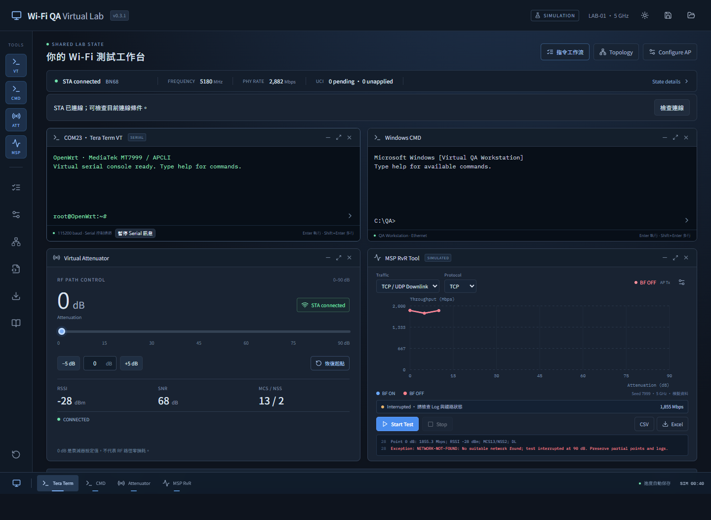
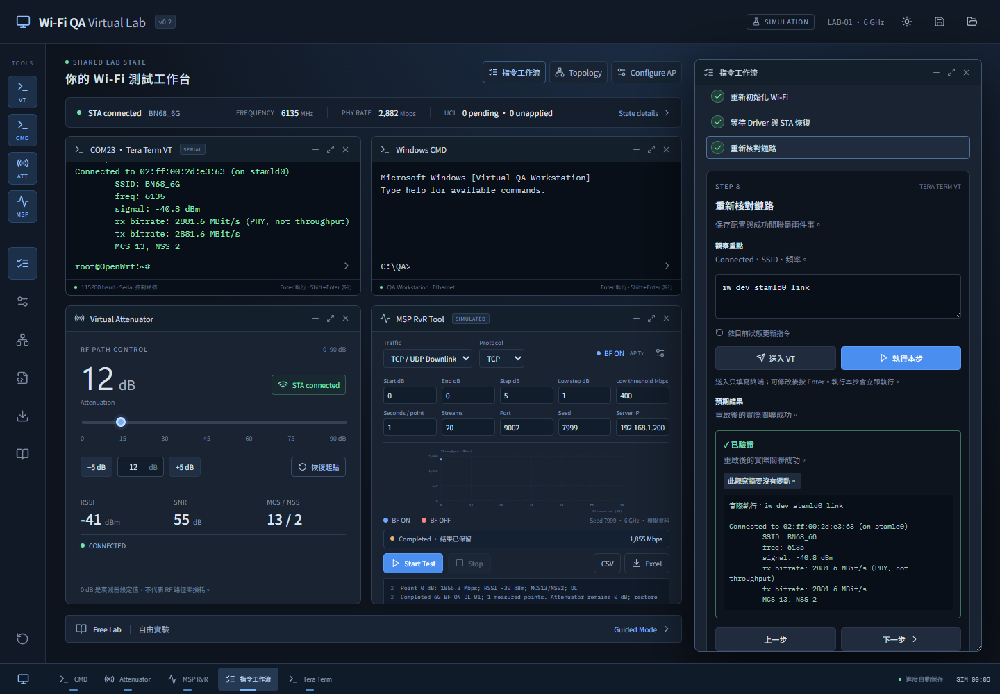
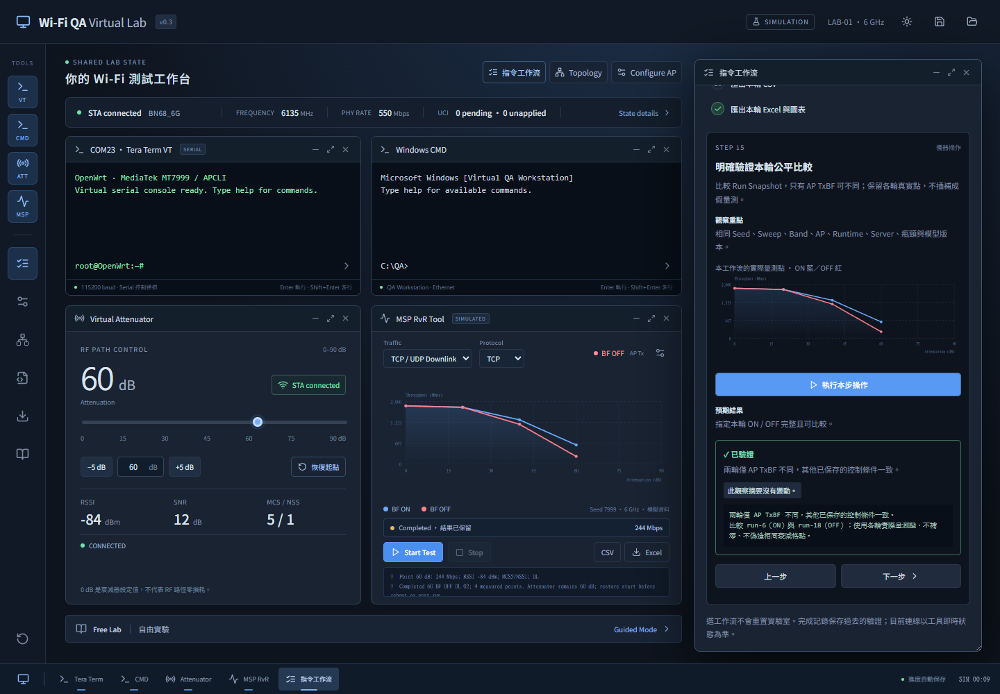

# Wi-Fi QA Engineer Simulator

可操作的繁體中文 Wi-Fi QA 虛擬實驗室。Tera Term、Windows CMD、AP、Attenuator 與 MSP 共用一個狀態引擎；所有 RF 和效能數值都是可重現的教學模擬，並非硬體量測。



[驗證紀錄與里程碑狀態](docs/validation.md)

本專案目前維護兩項工具：[兩項工作的範圍與狀態](docs/tasks.md)。

獨立的 **RvR Excel 繪圖工具 v1.2**：可直接貼 MSP 矩陣，按欄或按列選取 X／Y 與起訖範圍，支援 TxBF ON／OFF 比較、圖表大標題、曲線名稱／配色／線型／測點樣式、即時預覽與原生 Excel 圖表下載。Excel 圖表標題連結 A2、圖例連結 B6／E6，資料儲存格、數列來源與格式皆可繼續編輯；沒有工作表或圖表保護。取消凍結窗格並顯示格線。圖片 OCR 尚未加入。開發模式開啟 `/rvr-excel.html`；`pnpm build` 另產生可直接離線開啟的 `dist/rvr-excel-tool.html`。[操作說明](docs/rvr-excel-guide.md)及[可直接在 Excel 貼入資料的範本](docs/rvr-excel-template.xlsx)。

[RvR Excel 工具驗證紀錄](docs/rvr-excel-validation.md)

## 公開下載與 Fork

[下載 RvR Excel 工具 v1.2](https://github.com/kdeppaei/wifi-qa-engineer-simulator/releases/tag/rvr-excel-v1.2)：在 Assets 下載 `rvr-excel-tool.html`，用 Chrome／Edge 開啟即可離線使用；`rvr-excel-template.xlsx` 可直接在 Excel 填入資料。相同版本也附上 Wi-Fi QA 模擬器 `wifi-qa-lab.html`。

使用 RvR 工具時，貼上 MSP 矩陣，核對擷取的 dB／Throughput 欄；比較 TxBF 時選 ON／OFF 模式，分別貼入兩組資料，再下載 Excel。欄名、起始行與欄號皆可修改。公開下載不包含使用者提供的原始 PDF、試算表或量測資料。

要修改程式，按儲存庫右上角 **Fork**，再將自己的 Fork clone 到本機，依下方啟動步驟操作。RvR 工具程式位於 `src/rvrExcel/`，入口為 `rvr-excel.html`；Wi-Fi QA 模擬器與 RvR 工具共用此儲存庫，但各自有獨立入口。

## 啟動

需要 Node.js 22 或更新版本，以及 pnpm 10.26+（建議 pnpm 11）。

```sh
pnpm install
pnpm dev
```

開啟終端機印出的本機網址，通常是 http://127.0.0.1:5173/ 。資料只保存在該瀏覽器、該 origin 的 localStorage。首次啟動使用 6 GHz／BN68_6G；虛擬測試金鑰 `qa-lab-2026` 是專案合成資料。

也提供免安裝版：`pnpm build` 會產生 `dist/wifi-qa-lab.html`。用 Chrome／Edge 直接開啟此單一 HTML，即可操作相同的共用模擬引擎；核心功能不需要網路或伺服器。線上字型無法載入時使用系統字型。`file://` 與本機 dev server 各有獨立的瀏覽器存檔；可透過 JSON 快照交換。

```sh
pnpm build
pnpm lint
pnpm test
pnpm exec playwright install chromium
pnpm test:e2e
pnpm preview
```

Playwright 會啟動本機 dev server。已有相同版本 Chromium 時可省略 browser install。`PLAYWRIGHT_CHROMIUM_EXECUTABLE` 可指定現有 Chromium 執行檔。

## 指令工作流：邊操作邊驗證

v0.3.1 加入「檢查連線」。如果恢復衰減起點後仍持續出現 `NETWORK-NOT-FOUND`，展開檢查可核對 AP 電源／Channel、STA Runtime Radio／SSID、RF Readback、認證／PMF、Pending 與未載入配置。檢查只在你展開後顯示原因，保留故障練習的觀察過程。

「衰減設為 0 dB」使用實際 0 dB，不受先前保存的起點影響。「依目前 AP 同步 STA 並重連」會明確對齊 STA Radio、SSID、認證與 PMF，提交、載入 Committed 並重啟 Wi-Fi；設定衰減為 0 dB，但保留 AP、BF、Sweep、原量測與 Log。等待 restarting → scanning → associating → connected 後再用 link／Ping 驗證。若有 Pending、MSP 正在量測或 AP 條件無效，先處理提示的條件；操作不會替你清除 Pending、開啟 AP 或重跑測試。

VT 的「暫停 Serial 訊息」只暫停非同步訊息顯示，模擬與 Log 仍持續，手打／快捷指令仍可執行。按「繼續 Serial 訊息」接收後續事件，暫停期間的證據可用 `logread` 查詢。新訊息只捲動終端內容，不會強制捲動整個工作台；向上瀏覽歷史時停止追隨底部。

外部 Chrome／Edge 會沿用自己保存的現場，與 Codex 內建瀏覽器分開。更新 HTML 後重新載入並確認左上角版本為 v0.3.1；刷新本身不會清除故障或量測。

按工作台的「指令工作流」開啟右側面板。選擇工作流不會自動重置 AP、STA、衰減器或量測。每一步提供原因、觀察重點、可編輯的指令與預期結果；可以保留目前故障現場，照自己的速度操作。

| 工作流                         | 練習內容                                                                           |
| ------------------------------ | ---------------------------------------------------------------------------------- |
| 連線與流量方向基礎             | 分別確認 STA 關聯、DUT／PC IPv4、PC Server、Ping、UL 與 DL                         |
| UCI BF 設定生命週期            | 比較 Pending、Committed 與 Driver Runtime，提交後重新初始化並等待 STA 恢復         |
| 6G → 5G APCLI 遷移             | 先變更 AP，再查看及修改 STA SSID／Device，提交、重啟，最後驗證 5180 MHz 與 IP 路徑 |
| Reboot 後未連線：排查與恢復    | 從 link、配置、scan 與 Log 收集證據，核對 RF readback，再觀察重新掃描與關聯        |
| 完整 BF ON / OFF DL RvR 與匯出 | 19 步完成本輪 AP BF ON／OFF Sweep、同條件比較、CSV／原生 Excel／報告／Log 匯出     |

「送入 VT／CMD」只把指令填入真正的虛擬終端，不會執行；可在終端修改後按 Enter。「執行本步」會立即走同一條終端執行路徑，產生相同的設備變更、Log 與操作證據。手打指令、歷史、Tab 補完與多行輸入仍可使用。常用指令頁籤提供 26 個 VT／CMD 快捷選單；Radio、Server IP／Port 改變後，按「依目前狀態更新指令」取得新範本，避免覆蓋自己編輯中的內容。

驗證會一起查看實際輸出與共用狀態，分為準備、等待、成功與需要再檢查。回饋保留當時實際執行的指令、輸出與狀態摘要變化。`uci set`／`commit` 沒有 stdout 也可能成功；讀到 `0` 不等於 Driver Runtime 已套用。重啟後必須經過 restarting → scanning → associating → connected，等待頁會依實際狀態更新；不相容的 AP／SSID／認證不會因倒數結束而變成成功。已符合 5G 的步驟可按「檢查目前狀態（已符合可跳過）」明確驗證。

VT 在 `wpa_cli` 互動模式時，先按「退出 wpa_cli」或輸入 `quit` 再執行 Linux Shell 指令。DUT 作 Client 時，預設 UL、`-R` 為 DL；有線 PC 作 Client、DUT 作 Server 時，預設 DL、`-R` 為 UL。DL 的發送 BF 由 AP 決定，UL 才使用 STA Runtime BF。

故障工作流的「明確載入故障場景」是刻意建立新練習環境，會清除目前量測；面板在執行前提示，可先下載快照。單純切換工作流不會注入故障。工作流選擇、目前步驟、指令輸出與完成記錄保存在獨立 localStorage；完成代表當時驗證成功，目前連線仍以工具即時狀態為準。「重練」只清除本工作流進度、保留設備。JSON 實驗室快照不包含工作流進度；載入快照或重置實驗室會清除工作流進度，避免套用另一現場的完成記錄。

Learning Center 載入會重置設備的章節環境時，也清除工作流進度；故障工作流明確載入新場景時，清除該故障流程及 RvR 比較的記錄與 Run ID 綁定，避免把另一現場重用的編號當成原比較結果。



## 一條工作流完成 BF ON／OFF RvR

使用目前已連線的 AP／STA，可在同一個 5 GHz 或 6 GHz 環境完成比較。選「完整 BF ON / OFF DL RvR 與匯出」不會重置 Band、AP、STA 或舊結果；第一步「準備 DL / TCP 比較」只把 MSP 設為 DL／TCP，沿用目前 Sweep、Seed 與 Server 設定。

1. 在「MSP 量測參數」確認起點、終點、正常／低速步進、低速門檻、每點時間、Streams、Seed、Server IP／Port。End 必須大於 Start，完整結果至少兩點。首次預設為 0–60 dB、5 dB 正常步進、低速 1 dB、3 秒／點、20 streams、192.168.1.200:9002。
2. 依面板執行 STA link 查詢、在 Windows CMD 啟動有線 iperf3 Server、由 DUT Ping Server。STA 必須有效關聯，Pending 與尚未載入的配置須先處理，管理 Ethernet 繞行必須關閉。
3. 將 **AP TxBF 設為 ON**，把衰減器實際 Readback 恢復起點，等待 Connected。這是 DL 的發送端；不要拿 STA 的 `etxbfencond` 代替 AP BF。
4. 按「開始並捕捉本輪 ON」，再到「等待完整 ON Sweep」。面板保存新 Run ID、參數與 Metadata，顯示逐點累積、實際曲線及 running／completed／interrupted 狀態；不會拿先前的 ON 曲線代替本輪。
5. ON 完成後，衰減器仍在末值。按「回到已捕捉 ON 的起點」，等待 OFF 起點鏈路正常，再**只切 AP BF 為 OFF**。保留相同 Band、SSID、Channel、NSS、配置／協商頻寬、STA 三層設定、Seed、全部 Sweep／流量參數、Server 與 Ethernet 瓶頸。
6. 按「前檢並開始本輪 OFF」。任何控制條件不同都會阻擋開始，提示具體差異。若不慎改了 MSP 參數，可明確按「套用 ON 的量測參數」還原該組設定；這個按鈕不會修正 AP、STA、網路或衰減器。
7. 等指定 OFF 完整完成，再按「明確驗證本輪公平比較」。兩輪都必須完整包含起點與終點、無中斷、無繞行，且保存的控制條件只有 AP TxBF 不同。低吞吐自適應步進可能讓 ON／OFF 的衰減格點與點數不同；圖表使用各輪原始點，不補零、不偽造相同格點。
8. 依序執行四個「匯出本輪」操作。回饋顯示指定 ON／OFF Run ID、點數、檔名及 bytes，表示已產生並送出瀏覽器下載；檔案的儲存位置依瀏覽器設定。

| 工作流匯出                      | 內容                                                                                                      |
| ------------------------------- | --------------------------------------------------------------------------------------------------------- |
| `wifi-qa-bf-on-off.csv`         | 只含這兩輪的原始點，以及 Band、方向、實際發送 BF、STA 配置／Runtime BF、RF／PHY、Seed 與流量欄位          |
| `wifi-qa-bf-on-off.xlsx`        | Curve、Measurements、Metadata、Log；原生可編輯 XY 圖表恰有 BF ON／OFF 兩個 Series，直接參照真實資料儲存格 |
| `wifi-qa-bf-on-off-report.html` | 可離線開啟的 HTML／SVG 疊圖、兩輪組態與 Runtime 快照、原始點、保留現場 Log 及模擬限制                     |
| `wifi-qa-bf-on-off-test.log`    | 指定 Run ID、兩輪參數／Metadata／點資料及 ON 開始至 OFF 完成期間的保留現場事件                            |

完整 Channel、頻寬、AP／STA、Firmware／Model、網路與瓶頸 Metadata 保存在 XLSX、HTML 與證據 Log；CSV 是逐點資料表。Log 可能包含同期間其他操作，且工作區只保留最近 3000 條事件，不能當作完整硬體追蹤。

舊 Run 保留在 MSP／Result Analyzer；工作流的等待圖表、比較與四個匯出只使用本輪捕捉的 ON／OFF ID，不選最後兩條曲線。中斷或遺失的 Run 會阻擋正式比較與匯出，部分點仍可檢查。重新開始 ON 會清除本流程後續的驗證記錄，重新開始 OFF 會清除比較及匯出記錄；設備與舊 Run 不會被刪除。



## 第一條完整工作流程

1. 首次啟動為 6 GHz／BN68_6G。開啟「指令工作流」，選「6G → 5G APCLI 遷移」，明確執行第一步將 AP 改成 5 GHz／BN68。STA 保留 6 GHz 設定，會依真實共用狀態連線失敗。也可在 Learning Center 選 Chapter 5 載入該章練習環境。
2. 在 VT 查詢 `uci get wireless.stamld0.device`、`uci show wireless.stamld0`。錯誤的 SSID，例如 BN68_5G，無法關聯。依教材操作：

```sh
uci set wireless.stamld0.ssid='BN68'
uci -q delete wireless.stamld0.device
uci add_list wireless.stamld0.device='MT7999_1_2'
uci commit wireless
sync
wifi restart
```

3. 等待重新啟動、掃描與關聯，在 VT 執行：

```sh
iw dev stamld0 link
ip route get 192.168.1.200
bridge fdb show
ping -c 4 192.168.1.200
```

應看到 5180 MHz 和 Connected。單獨 Ping 成功不等於 Wi-Fi 路徑驗證；Topology 可啟用管理 Ethernet 繞行，MSP 會拒絕在該路徑作 Wi-Fi RvR。

4. 若要一併完成 Chapter 5 的 STA BF OFF 教材目標，先在任何 ON／OFF 比較開始前設定：

```sh
uci set wireless.MT7999_1_2.etxbfencond=0
uci commit wireless
wifi restart
```

`uci get`、Committed、Driver Runtime 為不同層。在 Result Analyzer 可並排查看。等待 STA Connected。也可用「UCI BF 設定生命週期」練習；新 DL 比較工作流要求兩輪之間維持相同 STA 配置。

5. 選「完整 BF ON / OFF DL RvR 與匯出」，照上述 19 步工作流確認環境、AP TxBF ON、恢復衰減起點並開始 ON，等待完整 Sweep。
6. 恢復同一起點、等待 Connected，只把 AP TxBF 切 OFF，再開始相同參數的 OFF。DL 的發送 BF 由 AP 決定；UL 才使用已套用的 STA BF。
7. 驗證指定 ON／OFF 完整且同條件，從工作流匯出本輪 CSV、原生可編輯 XLSX XY 疊圖、HTML/SVG 報告與證據 Log。MSP／Result Analyzer 的一般匯出保留整個工作區結果；曲線名稱仍可修改。
8. 完成比較後，可另開一輪 Sweep，在測試進行時把 Attenuator 調到 90 dB，會使 STA 斷線、MSP 中斷並保留已量測的點。Serial 控制連線仍可使用。
9. 在 VT 查 `iw dev stamld0 link`、`logread`、`wpa_cli -i stamld0 scan_results`；還原衰減起點後等待掃描、關聯，系統才逐步恢復。測試須自行重新 Start，原中斷 run 不會被覆寫。
10. 重新整理，設定、量測、Terminal VFS、操作歷史與教學進度仍在。儲存快照按鈕另下載 JSON；載入按鈕可恢復。正在跑的測試若重新整理，會標記中斷，避免杜撰頁面關閉期間的量測。

## 排錯任務

- Chapter 9：已 Commit 的設定保留，但 Reboot 後沒有網路；先看 link、Log 與 scan evidence，再檢查 RF 環境。提示分三層，第一層不揭示根因。
- Chapter 10：MSP Invocation Exception；透過 InnerException 排查 Server 與 Port，復原後完成 RvR。
- Guided、Practice、Troubleshooting 介面提供目標、操作證據與狀態回饋。所有章節有設備狀態／成功操作的驗收規則；Chapter 5、7、8、9、10 另外載入指定環境。Chapter 5 只接受完整且同條件的 5 GHz DL ON/OFF 比較，不接受單點或不同 Seed、頻寬、流量參數混搭。隨機故障組合、累積成績與完整敘事引導留待下一階段。

## 可操作功能與界線

- 桌面工具列、開始選單；視窗可拖曳、縮放、最大化、最小化、關閉及重新開啟。Native resize 位於浮動視窗右下角；拖動標題可使主工具浮動。提供基本淺色主題。
- Terminal 有歷史方向鍵、Tab 補完、Ctrl+C、Shift+Enter 多行；使用自製可測試的 parser，沒有連接主機 Shell。Linux、Windows CMD、wpa_cli 互動模式明確區分。
- Linux VFS、Pipe、redirect、變數、條件、bounded for/while、command substitution、基本算術。支援教材倒序 APCLI 清理腳本；未知或不支援語法會報錯。不是完整 Bash，沒有任意 host command 執行。
- UCI get/show/set/add/add_list/delete/rename/changes/commit，STA/AP 連線條件、RF、頻率、認證、PMF、IP 子網路、route、Bridge FDB、Counters、Server／Client。錯誤介面名稱會失敗。
- RF 模型包括固定 path loss、衰減、SNR、MCS/NSS、PHY、packet loss／retry 影響、方向、BF、頻寬、parallel streams、種子與 Ethernet bottleneck。高衰減會同時影響 scan 與關聯；scan Busy 模擬來自 concurrent scans。
- 直接輸入 `iperf3` 產生依當下設備狀態計算的彙總模擬；有時間進程的多點自動化在 MSP。iperf JSON／interval streaming、完整 Linux networking、真實 OS／VM、xterm／Monaco、PowerShell 與真實硬體接入尚未實作。
- MT7999 Radio 名稱與 `etxbfencond=3/0`、`UHR240` 的使用依本教材教學假設；不宣稱通用 Vendor 語義。實際協商寬度與配置字串分開保存。

## 結構

```text
src/engine/lab.ts       共用狀態、RF／IP 模型、MSP runner
src/engine/terminal.ts  Shell AST、虛擬檔案系統、UCI／Windows 命令
src/engine/export.ts    CSV、OOXML XLSX native chart、HTML 報告
src/engine/scenario.ts  實際查詢證據與狀態驗收、可比較的 ON/OFF 條件
src/engine/storage.ts   快照驗證與損壞存檔防護
src/engine/workflow.ts  指令範本、五條工作流及輸出／狀態驗證
src/engine/rvrWorkflow.ts  指定 Run ID、完整 RvR／同條件前檢與匯出子集
src/WorkflowView.tsx    工作流面板、指令送入／執行、獨立進度保存
src/App.tsx            多視窗操作、GUI、Terminal、章節與保存
src/style.css          深色工作台、桌面及響應式介面
tests/lab.spec.ts       實際瀏覽器完整因果流程
docs/source-notes.md    兩份 PDF 全文研讀筆記、假設與驗收對照
```

所有 GUI 與命令都透過同一個 `LabEngine`。每秒更新模擬時間；固定 Seed 相同條件可重現。將來可把 engine 的控制操作轉接到 WebSocket／遠端設備，不需要讓 GUI 各自維護網路狀態。

原理核對：[OpenWrt UCI](https://openwrt.org/docs/techref/uci)、[ESnet iperf3](https://software.es.net/iperf/invoking.html)。教學資料來自使用者提供的《WiFi_QA_Field_Guide_Compressed.pdf》（38 頁）及《Ubuntu虛擬機使用iperf3.pdf》（6 頁故障對話），PDF 未上傳儲存庫。
